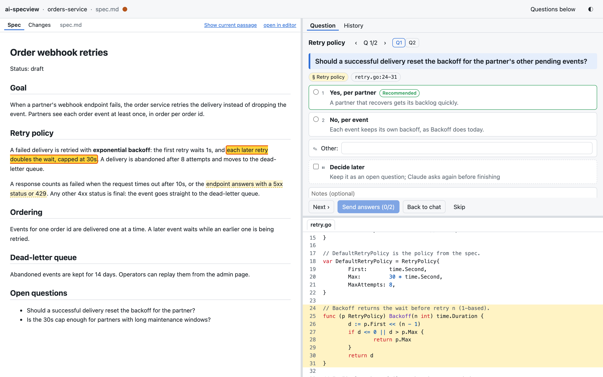
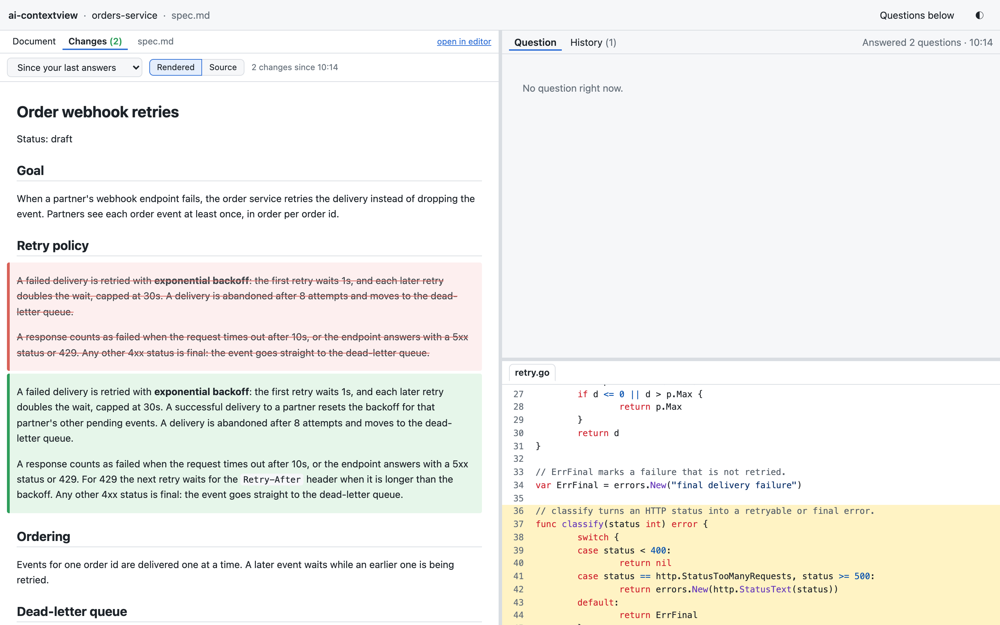
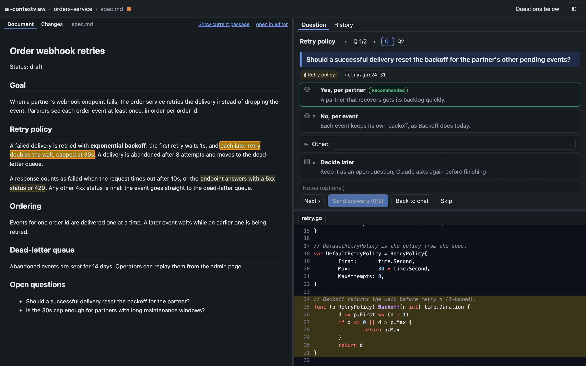

# ai-specview

ai-specview shows **the spec and the code side by side** while Claude elaborates a
spec. When a spec skill creates or edits the spec, the viewer shows it at once.
When the skill asks a question, the viewer highlights the spec passage being
asked about, opens the code at the right lines, and shows the question in a
docked panel that never blocks the rest of the page.

The viewer is a local web page served by a Go daemon. The MCP server and the
daemon are one binary, `ai-specview`. The plan and design are in [docs/](docs/README.md).



After you answer, the Changes tab shows what Claude changed in the spec since
your answers:



The page follows the system theme, and the ◐ button switches it:



The screenshots show the browser viewer with sample data.

## Install

ai-specview runs on Linux, macOS and Windows 10 or later. Install the binary
from the latest release:

```bash
go install github.com/rrgmc/ai-specview/cmd/ai-specview@latest
```

Releases are git tags such as `v1.2.0` (see the
[tags](https://github.com/rrgmc/ai-specview/tags)). To install one release, put
its tag after the `@`:

```bash
go install github.com/rrgmc/ai-specview/cmd/ai-specview@v1.2.0
```

Each release on the
[releases page](https://github.com/rrgmc/ai-specview/releases) also has
prebuilt binaries for Linux, macOS and Windows.
`@master` installs the newest commit
instead. `ai-specview version` prints the
installed version. After an upgrade, run `ai-specview serve --restart` so a
running daemon switches to the new binary.

Then install the Claude Code plugin. It registers the MCP server, the
`spec-elaborate` skill and the `ai-specview hook` (below) in one step:

```bash
claude plugin marketplace add rrgmc/ai-specview
```

```bash
claude plugin install ai-specview@ai-specview
```

In a session the same works with `/plugin marketplace add …` and
`/plugin install ai-specview@ai-specview`. In the desktop app, use **+** next to the
prompt, then **Add plugins**.

The plugin finds the binary on the `PATH`, in `$GOBIN`, in `$(go env GOPATH)/bin`
or in `~/go/bin`. Set `AI_SPECVIEW_BIN` to use another path. The plugin's skill is
named `ai-specview:spec-elaborate`. On Windows, the plugin runs through Git Bash,
which Claude Code already needs there.

If you set ai-specview up by hand before, remove the old pieces so they don't run
twice: `claude mcp remove ai-specview`, the `ai-specview hook` entry in
`~/.claude/settings.json`, and `~/.claude/skills/spec-elaborate`.

Also raise the MCP tool timeout (see below); a plugin can't set it.

### The pane instead of the browser

The plugin has a second skill, `ai-specview:spec-elaborate-mod`. It runs the
same workflow, but shows the spec, the code and the questions in a pane beside
the chat instead of the browser page. The pane is a Claude Code mod in the
plugin; it needs neither the binary nor the daemon. Ask for the pane (for
example "spec this in the pane") or name the skill. `/specview-pane` opens the
pane again after you close it. See [docs/06-pane-mod.md](docs/06-pane-mod.md).

### The browser page inside the desktop app

In the Claude desktop app, Claude opens the browser viewer in the app's
built-in browser after the first `spec_show`. The app may ask you to allow
`127.0.0.1` the first time. Where there is no built-in browser (the CLI, an
IDE), your default browser opens at the first question.

To use your default browser in the desktop app too, set
`AI_SPECVIEW_OPEN=browser` in the `env` block of your Claude Code settings,
or ask for it in the prompt:

```json
{
  "env": {
    "AI_SPECVIEW_OPEN": "browser"
  }
}
```

### Manual setup

Without the plugin, the binary must be on the `PATH` that Claude Code sees.

Register the MCP server for every project:

```bash
claude mcp add --scope user ai-specview -- ai-specview mcp
```

Or per project, in `.mcp.json` (see [examples/mcp.example.json](examples/mcp.example.json)):

```json
{
  "mcpServers": {
    "ai-specview": {
      "command": "ai-specview",
      "args": ["mcp"],
      "env": { "AI_SPECVIEW_ASK_WAIT": "600s" }
    }
  }
}
```

Raise the MCP tool timeout so a question can wait for the user. Set it in your
shell profile or in Claude Code's settings `env`:

```json
{ "env": { "MCP_TOOL_TIMEOUT": "1800000" } }
```

`AI_SPECVIEW_ASK_WAIT` must stay **below** `MCP_TOOL_TIMEOUT`. Then a long wait
ends with a `pending` result that Claude continues with `ask_wait`, instead of a
timeout error.

To keep Claude from falling back to its built-in question tool while a spec
is open, add the `ai-specview hook` PreToolUse hook to `~/.claude/settings.json`
(see [examples/settings.example.json](examples/settings.example.json)). It blocks
`AskUserQuestion` only in the Claude session that has a spec open in ai-specview,
so other sessions are not affected. Don't deny `AskUserQuestion` globally.

```json
{
  "hooks": {
    "PreToolUse": [
      {
        "matcher": "AskUserQuestion",
        "hooks": [{ "type": "command", "command": "ai-specview hook" }]
      }
    ]
  }
}
```

Copy [plugin/skills/spec-elaborate/](plugin/skills/spec-elaborate/) into
`.claude/skills/` (project) or `~/.claude/skills/` (user).

## Use it

1. Optionally add [examples/CLAUDE.md.snippet](examples/CLAUDE.md.snippet) to
   your `CLAUDE.md`.
2. Ask Claude to spec a change. The skill calls `spec_show`; the bridge starts
   the daemon if needed and Claude tells you the page URL
   (`http://127.0.0.1:7878/w/<workspace>`).
3. Each question arrives with its spec passage and code highlighted. Browse
   freely, then answer in the panel, choose "Decide later", go "Back to chat",
   or "Skip".

A new spec is a draft outside the repository, as plan mode does with plans, so
it needs no branch. The skill writes it to
`~/.claude/specs/<project>/<slug>.md`, and before it finishes asks whether to
move it into `docs/specs/`. To write a new spec in the repository from the
start, say so ("in the repo", "in docs/specs", or a path). An existing spec
you name is edited where it is. Both skills work this way.

`http://127.0.0.1:7878/` lists all sessions. Each Claude instance gets its own
workspace page; ended sessions stay readable, and `claude --resume` in the same
directory within 2 hours takes the old workspace over.

## Commands

| Command | What it does |
|---|---|
| `ai-specview mcp` | The stdio MCP server. Claude Code starts one per instance. |
| `ai-specview serve` | The viewer daemon. `--detach` starts it in the background, `--restart` replaces a running one (or starts one) in the background, `--stop` stops it, `--addr` sets the address (default `127.0.0.1:7878`, the next 9 ports are tried), `--idle-exit 30m` exits when unused. |
| `ai-specview fakeapp` | A terminal stand-in for the daemon, for testing the MCP path. |
| `ai-specview hook` | Claude Code PreToolUse hook: blocks the built-in question tool only while this session has a spec open. |
| `ai-specview version` | Prints the version: the git tag (`v1.2.3`), a Go pseudo-version for a build between tags, with `+dirty` for uncommitted changes, or `devel` when the build has no version information. |

## Environment

| Variable | Default | Meaning |
|---|---|---|
| `AI_SPECVIEW_ASK_WAIT` | `10m` | How long `ask` blocks before returning `pending`. |
| `AI_SPECVIEW_OPEN` | `pane` | `pane` asks Claude to open the viewer in the built-in browser of the Claude desktop app; when the user closed it, `ask` returns at once so Claude reopens it; without the pane, the default browser opens 10 seconds after a question arrives with no page open. `browser` always uses the default browser. `never` opens nothing. |
| `AI_SPECVIEW_SOCKET` | see below | Socket path shared by bridge and daemon. |
| `AI_SPECVIEW_ADDR` | `127.0.0.1:7878` | Daemon HTTP address. |
| `AI_SPECVIEW_DAEMON` | | Command the bridge runs instead of `ai-specview serve --detach` (for example `ai-specview fakeapp`). |

The socket is `$XDG_RUNTIME_DIR/ai-specview.sock` or, on macOS,
`~/Library/Caches/ai-specview/ai-specview.sock`, or, on Windows,
`%LOCALAPPDATA%\ai-specview\ai-specview.sock`. The detached daemon logs to
`ai-specview.log` in the same cache directory.

After upgrading, run `ai-specview serve --restart` so the running daemon matches
the new bridge.

## MCP tools

| Tool | Purpose |
|---|---|
| `spec_show` | Show a markdown file or a folder of artifacts; returns the section names and the page URL. |
| `focus` | Highlight a spec passage and open code without asking. |
| `ask` | Ask 1–6 questions with spec, doc and code refs; blocks until answered (or `pending`). |
| `ask_wait` | Keep waiting on a `pending` question set. |
| `spec_done` | Mark the spec finished; the page shows a "Spec finished" banner with the summary. |

The full contract is in [docs/01-protocol.md](docs/01-protocol.md).

## Develop

```bash
go test ./...
```

Golden protocol fixtures are in `protocol/fixtures/`, quote-matching fixtures
in `protocol/quotes/`. The browser tests in `internal/daemon/browser_test.go`
drive the question panel in headless Chrome; they are skipped when Chrome is
not installed, or with `go test -short`. `internal/e2e/multi_test.go` runs three
bridge processes against a real daemon, restarts and kills it, and resumes a
session (also skipped with `-short`).

The README screenshots in `docs/images/` are rendered in headless Chrome from
the sample spec and code in `internal/daemon/testdata/screenshots/`. After a
change to the page, render them again:

```bash
AI_SPECVIEW_SCREENSHOTS=docs/images go test -run TestScreenshots ./internal/daemon/
```

Check the plugin with `claude plugin validate ./plugin` and the marketplace
with `claude plugin validate .`. `claude plugin test ./plugin` runs the pane
mod's tests.

## Status

The first version (milestones M0–M7 in [docs/05-milestones.md](docs/05-milestones.md)) is
implemented. Differences from the plan:

- The front end is plain JavaScript (about 400 lines) instead of htmx, so
  nothing third-party is vendored.
- The web server, templates and assets live in `internal/daemon` instead of a
  separate `internal/web` package.
- The daemon also answers `ping` and `shutdown` messages, used by
  `serve` for its single-instance check and `--restart`.

The pane (`ai-specview:spec-elaborate-mod`,
[docs/06-pane-mod.md](docs/06-pane-mod.md)) is a prototype: its quote matching
has no fuzzy stage, Go symbols are found by a regular expression, and its
question form has no review step.

Not done yet: the change-folder skill steps and the `openspec status`
integration (M8), the handoff command (M9), and the dogfood sessions the
milestones ask for. The status per
milestone is in [docs/05-milestones.md](docs/05-milestones.md).

## Author

Rangel Reale (<rreale-c@sibros.tech>)

## License

MIT. See [LICENSE](LICENSE).
